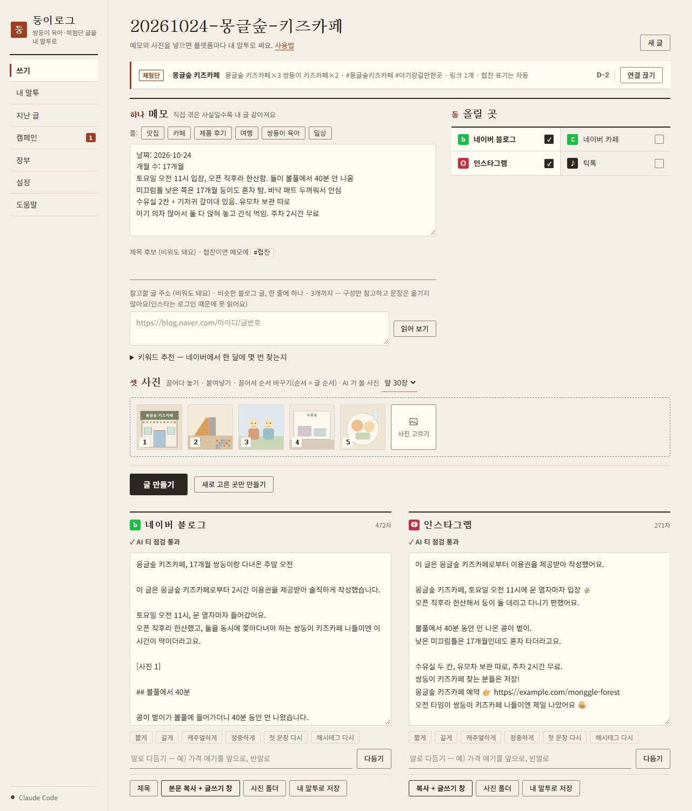

# DungiLog (둥이로그) — a writing desk app for twin parents who blog

> Formerly *PostKit*. The data folder keeps the old name (`PostKit`).

**Drop in a few photos and a short memo; DungiLog drafts posts for Naver Blog, Naver Cafe, Instagram and TikTok in *your* voice, and keeps track of campaign requirements, deadlines and income.** Posting stays manual by design. — [한국어](README.md)

## What it does

- **Per-platform drafts in parallel**, with the AI actually looking at the photos and placing `[photo n]` markers in order.
- **Your voice** — learns sentence length, endings and emoji habits from a few posts you wrote yourself.
- **Refine by talking** ("move the price up front"); Claude sessions are resumed so short instructions work.
- **"AI-ish" check, without calling the AI** — clichés, repeated sentence endings, suspiciously even paragraphs, repeated emoji, missing campaign keywords/tags/links. Shows "✓ passed" when clean.
- **Sponsored-review workflow** — required keywords (with counts), tags, links and notes per campaign; the legally required sponsorship disclosure line is inserted by code, not left to the AI; D-day badges; an income ledger with yearly totals and CSV export.
- **Phone mode** — opt-in LAN server with QR code + 6-digit PIN.

## Architecture in one paragraph

A single `DungiLog.exe` on Windows or `DungiLog.app` on macOS (PyInstaller) starts a standard-library `http.server` on `127.0.0.1` and opens Edge (Chrome/Edge/Brave on macOS, falling back to the default browser) in app mode. `ui.html` is one vanilla-JS page with no CDN. `gen.py` builds prompts and post-processes results, `ai.py` drives whichever CLI the user is already logged into (Claude Code, Codex, Gemini CLI) or a local Ollama, and `store.py` keeps everything as plain files in a data folder that can live in OneDrive. See [`docs/ARCHITECTURE.md`](docs/ARCHITECTURE.md) (Korean).

## Security highlights (all in code)

- Loopback-only UI server, `Host` header check, per-launch random `X-Token` for every state-changing request.
- Phone server only while enabled: fresh PIN each time (`secrets`, constant-time compare), 5 failures → 5-minute lockout, `HttpOnly; SameSite=Strict` session cookie, PC-only routes blocked.
- No API keys stored or read. Prompts go through stdin; Claude gets only the `Read` tool, Codex runs `--sandbox read-only`, Ollama is pinned to `127.0.0.1`.
- GPS EXIF is stripped from imported photos; children are referred to by nickname only.

## Principles

No auto-posting, no login automation, no multi-account tooling (Naver's terms ban it). Sponsorship and AI disclosures are never hidden — the app adds them.

## Tests

`python -m unittest discover tests` — 45 tests, no real AI calls (fake CLI binaries and a fake Ollama server). CI runs them on `windows-latest` with Python 3.10 and 3.12.

## License

All rights reserved — proprietary, planned for sale. Source is visible for portfolio review only.
