# 둥이로그 (DungiLog)

> 쌍둥이 엄마·아빠가 쓰려고 만든 글쓰기 앱 — 육아 일상과 체험단·협찬 글을 내 말투로. 예전 이름 「글 도우미(PostKit)」, 데이터 폴더 이름은 그대로 `PostKit`.

[](https://github.com/smh86278-stack/swbins-kit2/actions/workflows/test.yml)


**체험단·육아 블로거를 위한 글쓰기 데스크톱 앱 — 사진과 메모를 넣으면 네이버 블로그·카페·인스타그램·틱톡 글을 내 말투로 써 주고, 캠페인 조건·마감·수익 장부까지 챙긴다.** 올리기는 사람이 직접 한다. — [English summary](README.en.md)

## 하는 일

- **플랫폼별 초안** — 메모·사진 한 번으로 4개 플랫폼 글을 동시에(병렬) 만든다. 사진은 AI 가 직접 보고 글 순서(`[사진 1]`)에 맞춘다.
- **내 말투** — 예전에 직접 쓴 글 몇 편과 말투 메모를 넣어 두면 문장 길이·끝맺음·이모지 습관을 따라 쓴다.
- **말로 다듬기** — 「짧게」「캐주얼하게」 버튼이나 "가격 얘기를 앞으로" 같은 말로 고친다. 다듬는 동안 지금 글은 흐리게 남아 있다.
- **AI 티 점검** — AI 를 다시 부르지 않고 화면에서 뻔한 표현·같은 끝맺음 반복·자로 잰 문단·이모지 반복·캠페인 조건 누락을 짚는다. 걸린 게 없으면 「✓ AI 티 점검 통과」.
- **체험단 업무** — 캠페인마다 필수 키워드(횟수)·태그·링크·요구사항을 적어 두면 글에 넣고, 빠지면 알려 주고, 협찬·공구 표기 문장은 앱이 직접 넣는다. 마감 3일 전 배지, 「완료」하면 장부로.
- **수익 장부** — 받은 돈·물품 가액·글 주소, 연도 합계·월별 표, 엑셀용 CSV.
- **폰에서 쓰기** — 켤 때만 같은 와이파이에서 QR + 6자리 PIN 으로 들어온다.

## 화면

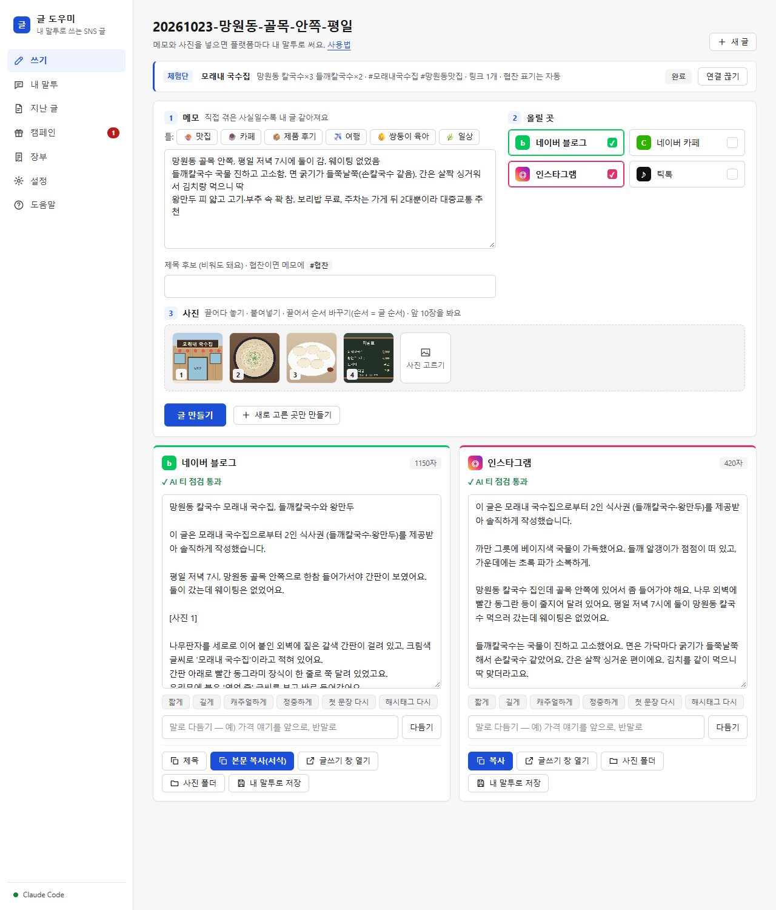

<details>
<summary>색 테마 3종 · 캠페인 · 장부 · 설정 · 폰 화면 더 보기</summary>

| | 기본 | 진한 사이드바 | 다크 |
|---|---|---|---|
| 쓰기 |  | 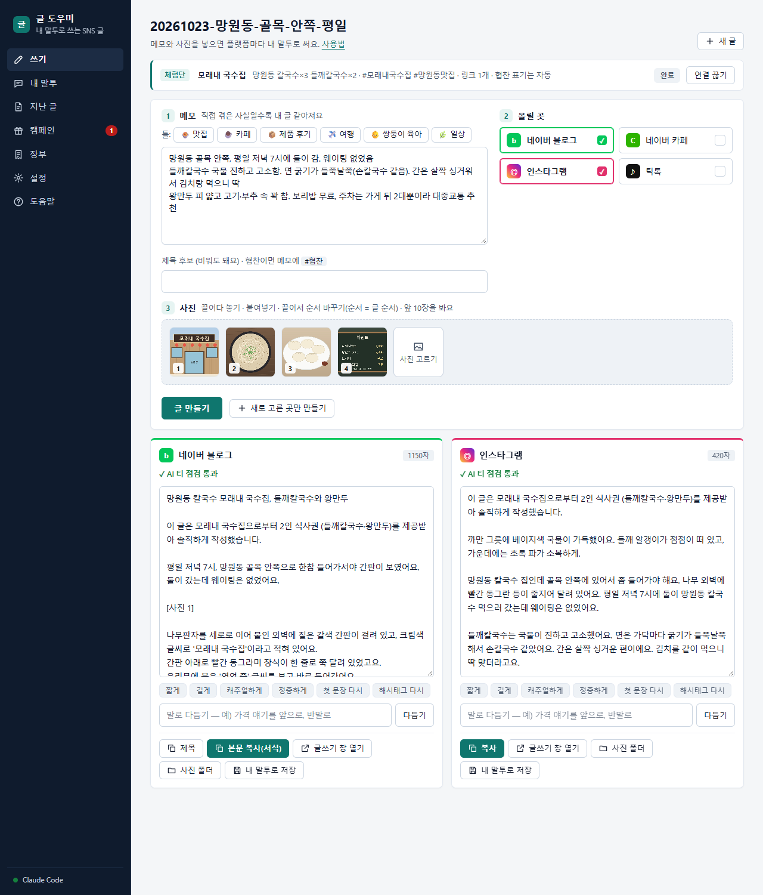 | 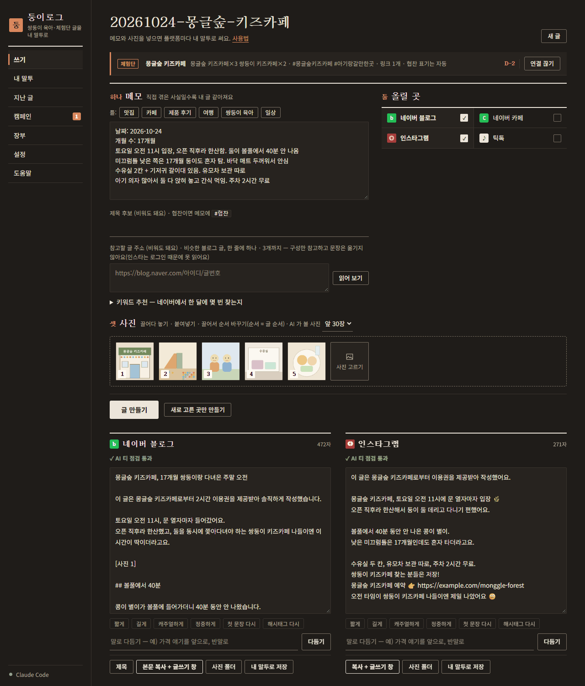 |
| 캠페인 | 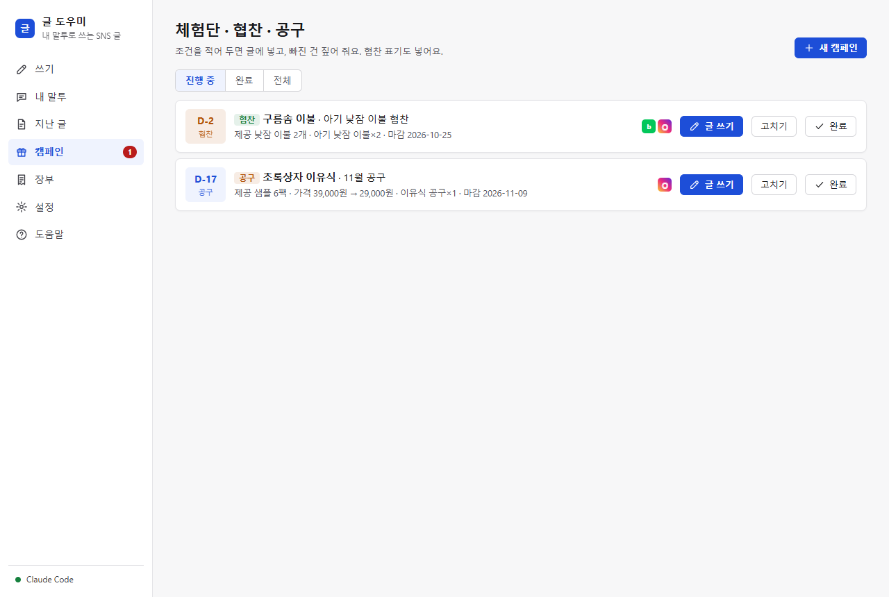 | 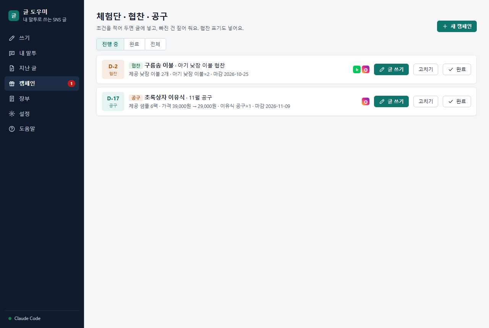 | 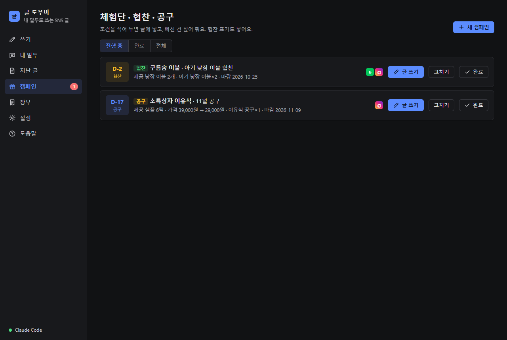 |
| 장부 | 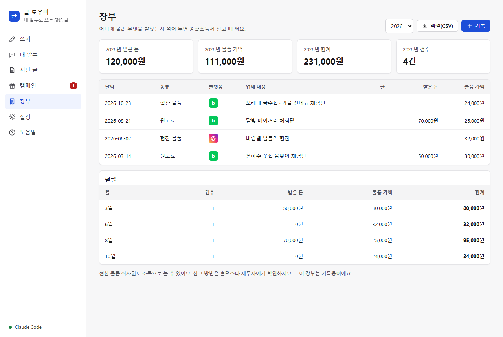 | 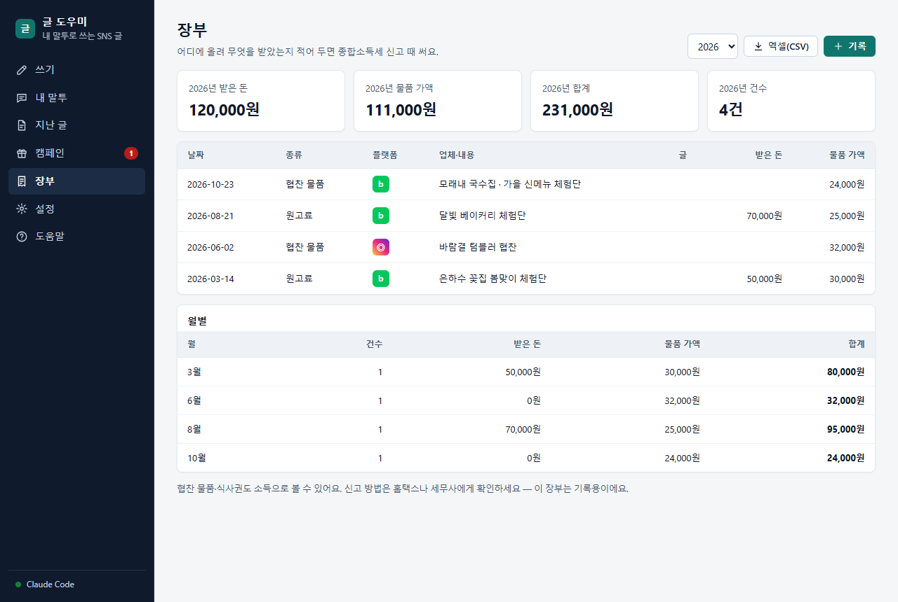 | 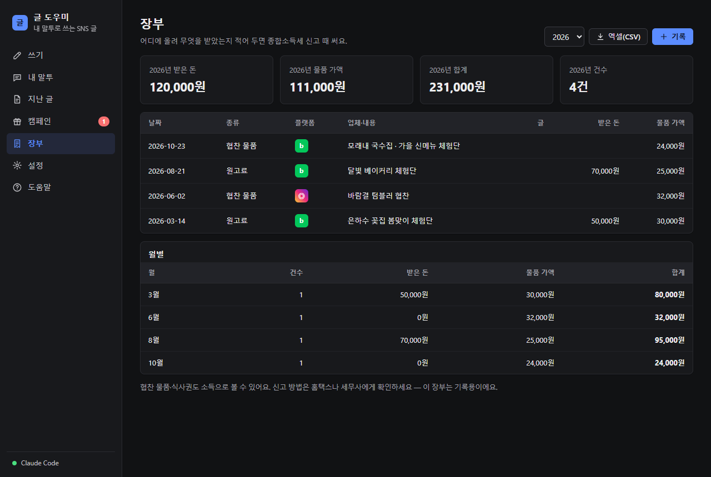 |
| 설정 | 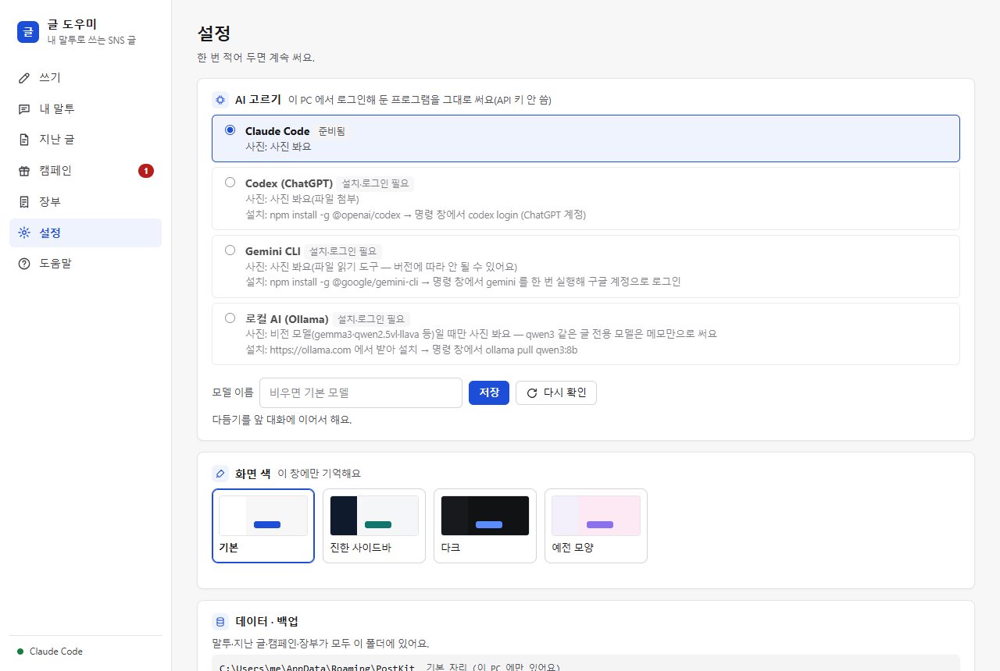 | 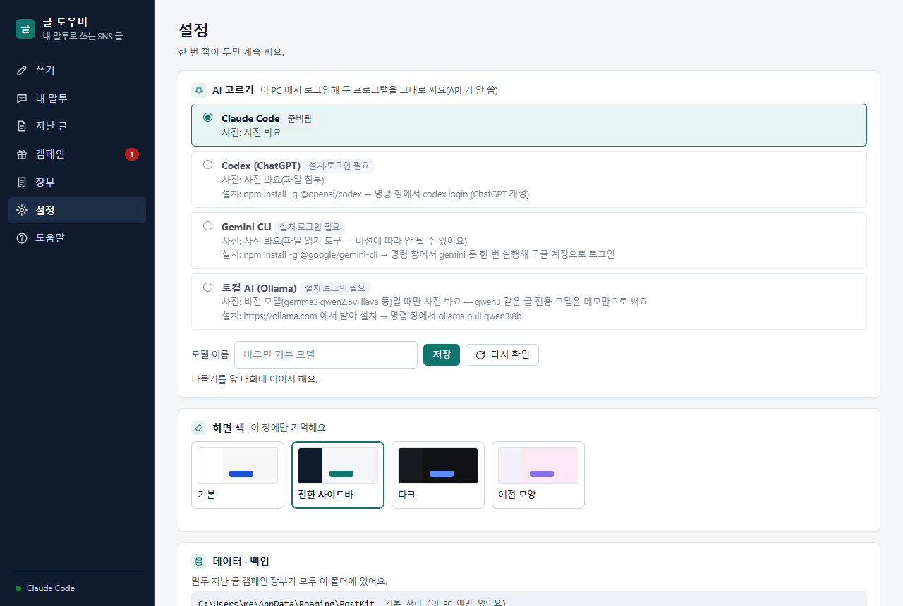 | 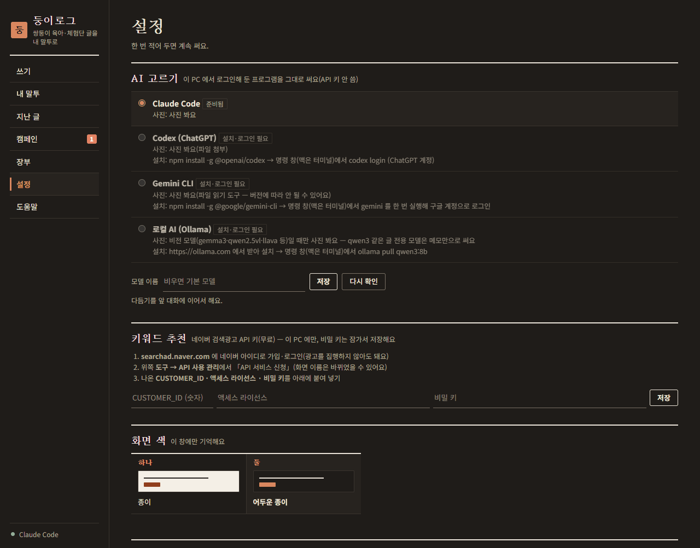 |

폰 화면(390px) — 탭이 아래로 내려간다:

 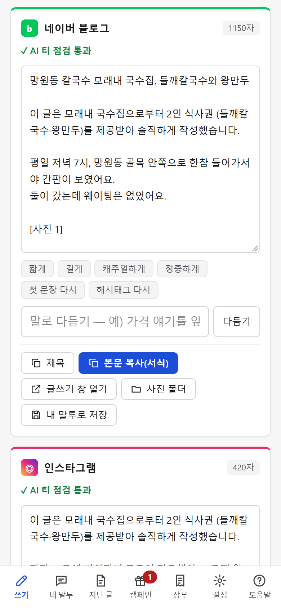  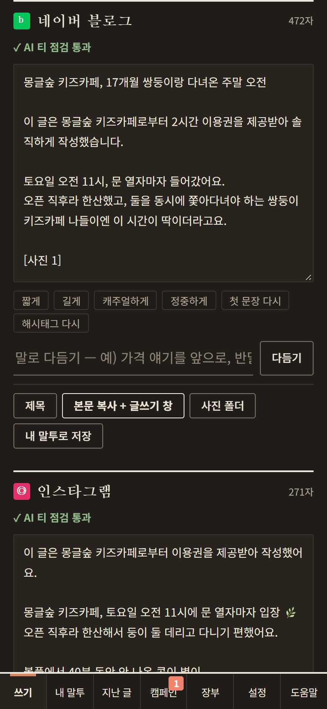

</details>

스크린샷의 업체·글·장부는 모두 가상의 견본이다.

**데모 영상** — 체험단 캠페인 등록 → 글 만들기 → 다듬기 → 장부까지 한 바퀴(약 2분). 요청하면 공유한다.
<!-- TODO: 짧은 GIF 를 docs/images/demo.gif 로 넣으면 여기에 -->

## 설치

**Windows 10/11**(Microsoft Edge — 기본 설치됨) 또는 **macOS**(Apple Silicon. Chrome·Edge·Brave 가 있으면 앱 창, 없으면 기본 브라우저 탭).

1. 글을 써 줄 AI 하나를 이 PC 에서 로그인해 둔다 — 기본은 [Claude Code](https://claude.com/claude-code)(`claude` 를 한 번 실행해 로그인).
   **설정 → AI 고르기**에서 Codex(ChatGPT) · Gemini CLI · 로컬 Ollama 로 바꿀 수 있다(아래 표).
2. [Releases](https://github.com/smh86278-stack/swbins-kit2/releases) 에서 `DungiLog.exe` 를 받아 실행한다. 설치 과정 없이 앱 창(Edge 앱 모드)이 뜨고,
   처음 한 번 바탕 화면·시작 메뉴 바로가기를 만든다. 창을 닫으면 잠시 뒤 스스로 끝난다.

### 맥에서

1. `DungiLog-mac.zip` 을 받아 풀고 `DungiLog.app` 을 **응용 프로그램** 폴더로 옮긴다(지금은 GitHub Actions 의 `DungiLog-mac` 아티팩트 — 릴리스에는 아직 없다).
2. **처음 한 번만** — 서명·공증을 하지 않은 앱이라 macOS 가 막는다.
   - macOS 14 이하: `DungiLog.app` 을 **우클릭(Control+클릭) → 열기 → 열기**.
   - macOS 15 이상: 한 번 더블클릭해 막힌 뒤 **시스템 설정 → 개인정보 보호 및 보안** 맨 아래 「그래도 열기」 → 암호.
   - 그래도 안 되면 터미널에서 `xattr -dr com.apple.quarantine /Applications/DungiLog.app`.
3. 앱 창이 뜬다(Dock 에는 아이콘이 없다 — 뒤에서 서버만 돈다). 창을 닫으면 1분쯤 뒤 스스로 끝나고, 그 사이 다시 켜면 아무 일도 없을 수 있으니 잠시 뒤 다시 켠다.
4. AI CLI 는 터미널에서 설치·로그인한다 — 예: [Homebrew](https://brew.sh) → `brew install node` → `npm install -g @anthropic-ai/claude-code` → `claude`.
   Finder 로 켠 앱은 PATH 가 짧지만, 앱이 로그인 셸 PATH 와 `/opt/homebrew/bin`·`/usr/local/bin`·`~/.local/bin`·`~/.npm-global/bin`·nvm 폴더까지 찾아본다.
5. 데이터는 `~/Library/Application Support/PostKit`, 로그는 `~/Library/Logs/PostKit/app.log`, 자동 백업은 `~/Library/Application Support/PostKit-local/backups`.
   설정의 「데이터 폴더 옮기기」에 iCloud Drive·OneDrive·구글 드라이브(`~/Library/CloudStorage`)가 보인다.

| AI | 준비 | 사진 | 다듬기 |
|---|---|---|---|
| Claude Code (기본) | `claude` 로그인 | 봄(Read 도구만 허용) | 앞 대화에 이어서(세션 이어받기) |
| Codex (ChatGPT) | `npm install -g @openai/codex` → `codex login` | 봄(`--image`, 읽기 전용 샌드박스) | 지금 글·규칙을 다시 붙여 새로 |
| Gemini CLI | `npm install -g @google/gemini-cli` → `gemini` 로그인 | 봄(read_file — CLI 버전에 따라 다름) | 새로 |
| 로컬 AI (Ollama) | [ollama.com](https://ollama.com) → `ollama pull qwen3:8b` | 비전 모델일 때만. 아니면 메모만으로 쓰고 알림 | 새로 |

## 주요 기능

| 묶음 | 기능 | 구현 |
|---|---|---|
| 쓰기 | 메모 틀 6종 · 사진 끌어 놓기/붙여넣기/순서 바꾸기 · 플랫폼별 병렬 생성 · 새로 고른 곳만 추가 생성 | `ui.html` · `app.py`(`/api/gen` 작업 + 폴링) |
| 프롬프트 | 공통 규칙(뻔한 표현 금지·지어내지 말고 `[확인: …]`) + 플랫폼별 한 장. 플랫폼 추가 = `platforms.json` 한 줄 + `prompts/<id>.md` | `gen.py` · `prompts/` |
| 다듬기 | 빠른 버튼 6개 · 말로 다듬기 · Claude 는 세션 이어받기 | `gen.py` · `ai.py` |
| 복사 | 블로그·카페는 제목 / 본문을 따로, 본문은 소제목·문단 **서식째**(HTML 클립보드) | `ui.html` `copyRich` |
| AI 티 점검 | 뻔한 표현 · 같은 끝맺음 50% 이상 · 문단 길이 변동계수 < 0.22 · 같은 이모지 4번 이상 · 캠페인 조건 | `ui.html` `lint()` |
| 사진 손질 | 긴 변 1600 · EXIF 회전 · GPS 있으면 다시 저장(위치 지움) · 찍은 날짜를 메모에 · 아기 개월 수 | `gen.py`(Pillow) |
| 캠페인 | 체험단·협찬·공구, 필수 키워드(횟수)·태그·링크·요구사항, 받침 따라 조사 붙는 표기 문장, D-day | `app.py` · `gen.apply_campaign` |
| 장부 | 연도 합계·월별 표·CSV(엑셀용 BOM) | `ui.html` · `/api/items` |
| 성장 기록 | 「개월 수」 있는 육아 글을 개월 순으로, 골라서 모은 메모 + 대표 사진으로 새 글 | `store.py` · `/api/growth` |
| 데이터 | 데이터 폴더 옮기기(OneDrive·구글 드라이브) · 백업 zip/되살리기 · 하루 한 번 자동 백업(7개) | `store.py` |
| 폰에서 쓰기 | 켤 때만 LAN 서버 · QR(자체 구현) · PIN · HttpOnly 세션 | `app.py` `PhoneHandler` · `qr.py` |
| 화면 | 사이드바 + 카드/표, 색 테마 기본·진한 사이드바·다크(+예전 모양), 좁은 화면은 아래 탭 | `ui.html` |

## 구조

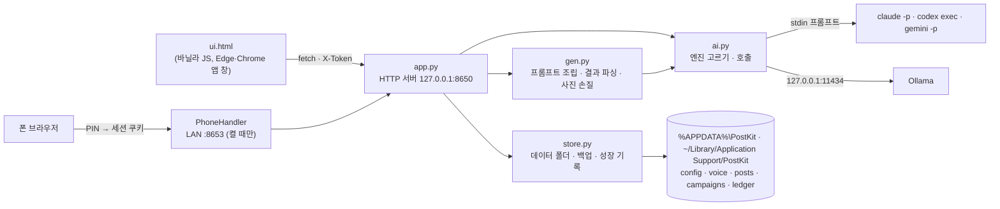

서버는 파이썬 표준 라이브러리(`http.server`)만 쓰고, 사진 손질에만 Pillow 를 쓴다. 화면은 외부 CDN 없이 `ui.html` 한 장.
자세한 설계와 결정 이유는 [`docs/ARCHITECTURE.md`](docs/ARCHITECTURE.md).

## 보안 · 개인정보 설계

코드에 실제로 있는 것만 적는다.

- **화면 서버는 `127.0.0.1` 에만** 열고, `Host` 헤더가 `127.0.0.1:<포트>`·`localhost:<포트>` 가 아니면 403(DNS 리바인딩 차단).
- **상태를 바꾸는 POST 는 토큰 필요** — 띄울 때마다 `secrets.token_urlsafe(24)` 로 새로 만들어 화면에만 심고, `X-Token` 헤더로 확인한다. 파일로 남기지 않는다.
- **폰 서버는 켤 때만** LAN 주소에 연다. 켤 때마다 바뀌는 6자리 PIN(`secrets.randbelow`, 비교는 `compare_digest`), 5번 틀리면 5분 잠금,
  통과하면 `HttpOnly; SameSite=Strict` 세션 쿠키(12시간). 폰에선 폴더 열기·바로가기·데이터 옮기기·백업·폰 설정 길(`PHONE_ONLY_PC`)을 막는다.
- **API 키를 쓰지 않는다** — 각 AI CLI 에 사용자가 직접 로그인한 것을 띄울 뿐, 계정 정보·토큰을 읽거나 저장하지 않는다.
- **AI 에게 손발을 주지 않는다** — 프롬프트는 stdin 으로 넘기고, Claude 는 `--allowedTools Read`(사진 보기)만·쓰기/명령/웹 도구는 `--disallowedTools`,
  Codex 는 `--sandbox read-only`, Ollama 는 `127.0.0.1:11434` 고정.
- **사진 위치 정보 지움** — 앱에 넣은 사진에 GPS 가 있으면 작은 사진이라도 다시 저장해 EXIF 를 버린다. 원본 사진은 건드리지 않는다.
- **아이 정보** — 설정에 애칭을 넣으면 글에는 애칭만 쓰고 실명·생년월일·병원·어린이집·동네는 빼라는 규칙을 프롬프트에 붙인다. 생일은 개월 수 계산에만 쓴다.
- **경로 탈출 차단** — 글·사진·말투 파일 이름은 정규식과 `gen.inside()`(데이터 폴더 밖이면 거부)로 확인. 요청 본문은 JSON 2MB · 파일 30MB 까지.
- **회사 OneDrive 경고** — 회사 OneDrive(윈도우 `OneDriveCommercial`, 맥 `~/Library/CloudStorage/OneDrive-<회사>`)가 있는 PC 면 데이터 설정 칸에 "개인 부업 자료를 두지 말라"는 경고를 띄운다.

## 원칙

- **자동 발행하지 않는다** — 네이버는 자동 프로그램으로 글을 올리는 걸 약관으로 막고 계정 정지까지 간다. 앱은 「글쓰기 창 열기 + 클립보드 복사」까지만 한다.
  로그인 자동화·여러 계정 돌리기도 만들지 않는다.
- **광고·AI 표시를 숨기지 않는다** — 협찬·공구 표기 문장은 오히려 앱이 직접 넣는다(표시광고법). 「AI 티」는 속이는 기능이 아니라
  내 말투·구체적인 사실 재료·뻔한 표현 걷어내기로 푼다.
- **지어내지 않는다** — AI 가 모르는 사실은 `[확인: …]` 로 비워 두게 하고, 화면에서 다시 짚는다.

## 시험 실행

```
python -m pip install pillow          (사진 시험용 — 없으면 그 시험만 건너뛴다)
python -m unittest discover tests     49개 — 플랫폼별 데이터 자리·프롬프트·파싱·협찬 표기·사진 손질·AI 엔진(가짜 CLI·가짜 Ollama 서버)·저장소·QR·릴리스 스크립트
```

진짜 AI 는 부르지 않는다. GitHub Actions 가 `windows-latest`·`macos-latest` × 파이썬 3.10·3.12 로 같은 시험을 돌리고,
두 OS 에서 빌드(exe·.app)한 앱을 창 없이 띄워 화면·API 스모크 시험(`tests/smoke.py`, Playwright 스크린샷)까지 한다(`.github/workflows/test.yml`).

개발 중 앱 띄우기 — 시험 데이터를 분리해서:

```
set POSTKIT_DATA=%TEMP%\postkit-test
python -X utf8 -c "import app; app.PORT=8651; app.main()" --no-window
python build.py                       윈도우 dist\DungiLog.exe (한 파일) · 맥 dist/DungiLog.app + DungiLog-mac.zip
```

## 라이선스

All rights reserved. 판매 예정인 비공개 소프트웨어라 오픈소스 라이선스를 붙이지 않는다. 코드 열람은 포트폴리오 검토 목적에 한한다.
